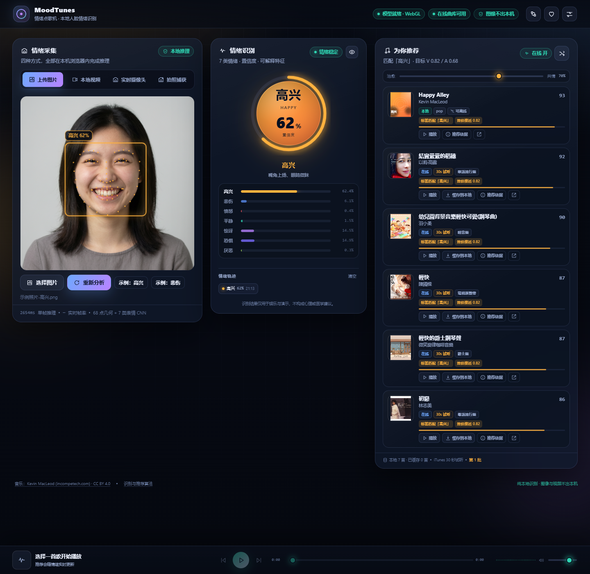

# MoodTunes · 情绪点歌机

> 纯浏览器本地运行的人脸情绪识别 + 情绪化歌曲推荐。上传图片、打开视频、开启摄像头或拍照，识别 7 类情绪，并按可解释的推荐公式生成歌单；内置 7 首 CC BY 4.0 器乐曲，在线补充 iTunes 30 秒试听。



## 技术栈

| 层次 | 选型 |
|---|---|
| 标记与样式 | HTML5 语义化标签、CSS3（自定义属性、Grid/Flex、渐变与滤镜动画） |
| 应用框架 | Vue 3.5（`<script setup>` 组合式 API），无 Vuex/Pinia，状态用模块级 `reactive` 单例 |
| 构建工具 | Vite 7 + `@vitejs/plugin-vue` |
| 人脸推理 | `@vladmandic/face-api` 1.7（TensorFlow.js，WebGL 优先、CPU 降级） |
| 本地持久化 | localStorage（设置/历史）、IndexedDB（试听缓存） |
| 代码形态 | 原生 JavaScript ESM，纯逻辑与视图分层，纯函数可被 `node --test` 覆盖 |

## 在线演示

<https://mood-tunes-uj4n0rvmcvy.qoder.website/>（HTTPS，可直接授权摄像头；识别仍在浏览器本机完成，图像不出本机）

## 特性

- **四种采集方式**：上传图片（含拖拽、示例照片）、本地视频文件、实时摄像头、拍照捕获（冻结帧高分辨率分析）。
- **纯本地识别**：`@vladmandic/face-api` 的 TinyFaceDetector + 68 关键点 + 7 类表情 CNN，模型从 `public/models` 加载，WebGL 推理，CPU 自动降级；图像、视频、关键点均不上传。
- **可解释融合算法**：68 点几何特征（嘴角、眉眼、张口、抿嘴等）与表情 CNN 按权重融合，输出 7 类概率、置信度、质量门控与逐项贡献；内置算法调试面板。
- **明确推荐规则**：情绪 → 目标效价/唤醒度 → 标签匹配 + 效价/唤醒度接近度 + 新鲜度 + 本地加成 + 种子抖动 → 多样性重排；结果至少保留 1 首本地/已缓存曲目。
- **本地 + 在线曲库**：7 首 Kevin MacLeod CC BY 4.0 器乐曲直接随项目分发；iTunes Search API 提供 30 秒试听与封面；试听可缓存到 IndexedDB，断网可播。
- **深色霓虹 UI**：情绪色随结果变化，情绪球、7 类概率条、情绪轨迹、音频可视化、响应式布局与键盘可访问。

## 快速开始

环境要求：Node.js ≥ 20.19（开发时使用 Node 24.20 / npm 11.19）。

```bash
git clone https://github.com/susevenci/mood-tunes.git
cd mood-tunes
npm install
npm run dev
```

打开 <http://localhost:5173>。Windows 用户也可以直接双击 `start.cmd`，首次会自动安装依赖。

首次 `npm install` 需要网络；之后模型、本地曲库、已缓存歌曲都可以离线使用。摄像头需要 `localhost` 或 HTTPS（浏览器安全上下文要求）。

### 快速演示

- 打开 `http://localhost:5173/?demo=happy`：自动加载示例高兴照片并分析。
- 打开 `http://localhost:5173/?demo=sad`：自动加载示例悲伤照片。
- 也可以在「上传图片」面板点击「示例：高兴 / 示例：悲伤」按钮。

示例照片由图像生成工具合成，仅用于演示。

## 使用流程

1. **采集**：选择图片/视频/摄像头/拍照。实时模式约 8 FPS（CPU 降级 4 FPS），单张图片使用更高输入分辨率。
2. **识别**：模型检测最大人脸，输出 68 点与 7 类表情；几何特征与 CNN 融合后给出情绪、置信度和质量提示。
3. **推荐**：稳定情绪变化后自动刷新歌单；可拖动「治愈 ↔ 共情」滑杆改变目标向量，或点「换一批」。
4. **播放**：本地曲目直接播放；在线试听可「缓存到本地」，随后断网仍可播放。

## 算法规格

完整的公式、权重、阈值、质量门控、时间平滑与调参指南见：

- [docs/architecture.md](docs/architecture.md) —— 代码结构梳理（分层、模块职责、数据流、扩展指引）
- [docs/algorithm.md](docs/algorithm.md) —— 人脸情绪识别算法
- [docs/recommendation.md](docs/recommendation.md) —— 情绪到歌曲的推荐规则

摘要：

```text
工作画布 → TinyFaceDetector → 68 关键点 → 去滚转/瞳距归一化
        → 几何特征 + 表情 CNN 加权融合 → P(e) 归一化
        → 质量门控 → 中值 + EMA + 滞回 → 稳定情绪
        → 目标 V/A 插值 → 标签/效价/唤醒度/新鲜度/本地/抖动打分
        → 多样性重排 → 至少 1 首本地兜底
```

当前融合权重（每行合计 1.0，代码位于 `src/core/emotion/scoring.js`）：

| 情绪 | 几何项 | 表情项 |
|---|---|---|
| 高兴 | smile .20 + mouthWidth .10 + eyeSquint .10 | happy .60 |
| 悲伤 | frown .20 + innerBrowRaise .12 + lipPress .08 | sad .60 |
| 愤怒 | browFurrow .10 + browSlope .08 + lipPress .12 + eyeSquint .10 | angry .60 |
| 惊讶 | eyeWide .15 + mouthOpen .15 + browRaise .05 | surprised .65 |
| 恐惧 | eyeWide .12 + innerBrowRaise .10 + browRaise .06 + mouthOpen .06 | fearful .66 |
| 厌恶 | upperLipRaise .10 + lipPress .05 + browFurrow .03 | disgusted .82 |
| 平静 | lowActivation .15 + (1 − maxGeo) .10 | neutral .75 |

## 曲库

### 本地预下载（7 首）

| 情绪 | 曲目 | 作者 | 许可 |
|---|---|---|---|
| 高兴 | Happy Alley | Kevin MacLeod | CC BY 4.0 |
| 悲伤 | Heartbreaking | Kevin MacLeod | CC BY 4.0 |
| 愤怒 | Volatile Reaction | Kevin MacLeod | CC BY 4.0 |
| 平静 | Peaceful Desolation | Kevin MacLeod | CC BY 4.0 |
| 惊讶 | Monkeys Spinning Monkeys | Kevin MacLeod | CC BY 4.0 |
| 恐惧 | Anxiety | Kevin MacLeod | CC BY 4.0 |
| 厌恶 | The House of Leaves | Kevin MacLeod | CC BY 4.0 |

完整署名与许可证链接见 [`public/audio/local/ATTRIBUTION.md`](public/audio/local/ATTRIBUTION.md)，页面页脚和「音乐与署名」弹窗中同步展示。

### 在线补充（iTunes Search API）

- 端点：`https://itunes.apple.com/search?term=…&media=music&entity=song&limit=20&country=tw|us`
- 免密钥、CORS 开放，提供 30 秒试听 `previewUrl` 与封面；在线结果的 V/A 是按检索词映射的代理值，**不做音频分析**。
- 每次刷新最多 1 个请求，全局最小间隔 1.5s，相同 `country:term` 缓存 10 分钟；429/403 会提示限流并只保留本地。
- 「缓存到本地」把试听 Blob 存入 IndexedDB（上限 30 首 / 150MB，LRU 淘汰），断网可播放。
- 适配层位于 `src/core/recommend/providers/`：已注册 `local`、`cache`、`itunes`，并预留未启用的第三方源接口。

## 隐私

- 人脸检测、关键点、表情识别、推荐计算全部在本机浏览器内完成，没有任何图像/视频上传接口。
- 情绪历史只保存标签、置信度、时间与采集方式，保存在 localStorage，可一键清空。
- 只有在线曲库检索会访问 `itunes.apple.com`；关闭「在线曲库」后完全离线。
- 无统计脚本、无外部字体、无 CDN 依赖。

## 浏览器支持

推荐 Chrome / Edge 110+。Safari / Firefox 可运行，但 WebGL 性能、音频格式与 IndexedDB 行为可能有差异。摄像头需要 `localhost` 或 HTTPS；`file://` 直接打开无法加载模型和 ES Module。

## 项目结构

```text
mood-tunes/
├─ index.html              # Vite HTML 入口
├─ vite.config.js          # 构建配置（dev 端口 5173，排除 face-api 预打包）
├─ start.cmd               # Windows 一键启动
├─ public/                 # 静态资源，构建时原样复制
│  ├─ models/              # face-api 三组权重（由 npm run setup:assets 生成，不入库）
│  ├─ audio/local/         # 7 首本地 MP3 + ATTRIBUTION.md
│  ├─ covers/              # 7 张情绪渐变封面
│  └─ demo/                # 示例高兴/悲伤照片
├─ scripts/
│  ├─ prepare-assets.mjs   # 从 node_modules 复制模型
│  ├─ download-audio.mjs   # 下载 CC BY 曲目（已执行，文件随项目保留）
│  └─ generate-covers.mjs  # 生成 SVG 封面
├─ src/
│  ├─ main.js              # 应用入口
│  ├─ App.vue              # 页面骨架与情绪主题变量
│  ├─ config.js            # 全局阈值、权重、限流、缓存上限
│  ├─ core/                # 纯逻辑层（不依赖 Vue）
│  │  ├─ emotion/          # 几何、评分、平滑、face-api 封装、overlay
│  │  ├─ recommend/        # 推荐配置、排序、iTunes/local/cache Provider
│  │  └─ storage/          # IndexedDB、设置、历史、音频缓存
│  ├─ composables/         # 采集、推荐、播放、设置、摄像头
│  ├─ components/          # capture/emotion/recommend/player/layout/ui
│  ├─ stores/uiState.js    # 全局 UI 状态与 toast
│  ├─ data/localSongs.js   # 本地曲库元数据与署名
│  └─ styles/              # tokens.css 设计变量 + base.css 基础样式
├─ tests/                  # node --test 单测（26 例）
├─ docs/                   # 结构梳理、算法与推荐文档、截图
└─ README.md
```

分层依赖为单向：`components → composables → core → config`，`core` 不引入 Vue，因此可直接被 Node 单测覆盖。完整模块清单、数据流与扩展指引见 [docs/architecture.md](docs/architecture.md)。

## 测试与构建

```powershell
npm test          # 26 个纯函数测试：几何/评分/平滑/排序/iTunes 映射
npm run build     # 生产构建到 dist/
npm run preview   # 预览生产构建（默认 http://localhost:4173）
```

自动测试不依赖浏览器或模型文件，只覆盖纯函数。浏览器端请按以下清单人工验收：

1. 上传示例高兴照片 → 高兴（约 62%），推荐第一首为本地 Happy Alley。
2. 上传示例悲伤照片 → 悲伤（约 58%），推荐以本地 Heartbreaking 为匹配项。
3. 摄像头 → 实时框/68 点/标签，停止后摄像头指示灯熄灭。
4. 视频文件 → 播放时实时识别，暂停后可「分析当前帧」。
5. 拍照捕获 → 冻结帧、全分辨率分析、可重新拍照。
6. 在线试听 → 播放 30 秒；缓存后断网仍可播放。
7. DevTools Network → 识别过程无外部请求；仅 iTunes/封面为外部请求。

## 已知限制

- 表情模型为通用 7 类模型，对侧脸、强逆光、遮挡、儿童和合成人像的准确率有限；结果仅用于娱乐与演示，不构成心理/医学建议。
- 在线曲目只有 30 秒试听；在线 V/A 是关键词代理值，不是音频分析结果。
- 摄像头需要安全上下文；不支持的浏览器会给出错误提示。
- 本地音频约 32.4MB，构建产物会包含这些文件。

## 音乐与模型署名

- 本地音乐：Kevin MacLeod（<https://incompetech.com/>），CC BY 4.0。固定署名格式：
  `"<Title>" Kevin MacLeod (incompetech.com) Licensed under Creative Commons: By Attribution 4.0 License http://creativecommons.org/licenses/by/4.0/`
- 人脸模型：[@vladmandic/face-api](https://github.com/vladmandic/face-api)（MIT），模型权重随 npm 包分发。
- 在线试听：Apple iTunes Search API，试听片段版权归原权利人所有，不做再分发。

## 许可

代码采用 MIT 许可；本地音乐为 CC BY 4.0；face-api 及模型为 MIT。详见 [LICENSE](LICENSE) 与 [`public/audio/local/ATTRIBUTION.md`](public/audio/local/ATTRIBUTION.md)。
